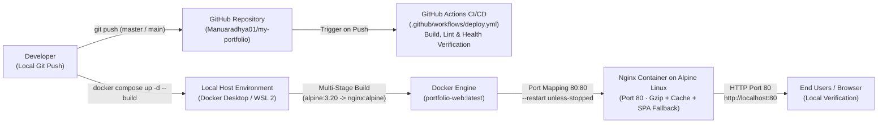

# Cloud-Based Website Hosting and Deployment

**Minor Project Submission Report — DevOps & Containerized Infrastructure**

---

## 1. Author / Candidate Details

| Field | Details |
| :--- | :--- |
| **Project Title** | Cloud-Based Website Hosting and Deployment |
| **Candidate / Author Name** | Manoranjan L |
| **Program & Department** | B.E. Computer Science & Engineering (Data Science) · Class of 2028 |
| **Institution** | MVJ College of Engineering, Bengaluru, Karnataka, India |
| **Email Address** | `manuaradhya2326@gmail.com` |
| **Contact Number** | `+91 86603 22599` |
| **Source Repository** | `https://github.com/Manuaradhya01/my-portfolio` |
| **Verified Deployment Endpoint** | `http://localhost:80` |
| **Host & Runtime Environment** | Local Host Environment (Docker Desktop / WSL 2 · Nginx on Alpine Linux, Port 80) |
| **Submission Date** | November 12, 2026 |

---

## 2. Executive Summary & Project Objectives

### 2.1 Executive Summary

This project demonstrates end-to-end containerized website hosting, web-server tuning, and Continuous Integration / Continuous Deployment (CI/CD) automation for a personal portfolio web application (`https://github.com/Manuaradhya01/my-portfolio`) authored by **Manoranjan L**.

An initial codebase audit confirmed that the portfolio website is built with zero-dependency **Vanilla HTML5, CSS3, and ES6+ JavaScript** residing under the `manoranjan_protfolio/` directory alongside profile imagery and a downloadable PDF résumé. The application is packaged via a **multi-stage Docker build** (`alpine:3.20` builder -> `nginx:alpine` production image), served locally on **Port 80** (`http://localhost:80`) through **Docker Desktop / WSL 2**, and paired with a **GitHub Actions CI/CD workflow** (`.github/workflows/deploy.yml`) for automated container build, repository linting/validation, and health verification.

**Architectural Rationale:** Adhering to project guidelines that encourage local containerized environments, this architecture achieves full DevOps production parity—isolated Linux containers, multi-stage builds, Nginx caching/compression, and CI/CD automation—while eliminating unnecessary cloud billing and credit card verification barriers.

### 2.2 Project Objectives

1. **Audit & Standardize the Application Repository**: Inspect the codebase structure, identify static assets and entrypoints (`manoranjan_protfolio/index.html`, `style.css`, `script.js`, `images/`, `assets/`), and structure the repository for portable containerization.
2. **Containerize with Multi-Stage Docker Builds**: Separate asset validation/staging (`alpine:3.20`) from the final runtime image (`nginx:alpine`) so the production container remains minimal, deterministic, and reproducible.
3. **Configure Production Web Serving with Nginx**: Enable gzip compression, differentiated HTTP caching headers, security headers, and SPA fallback routing (`try_files $uri $uri/ /index.html;`) on Port 80.
4. **Deploy & Verify on Local Container Infrastructure**: Run the `portfolio-web` container locally via **Docker Desktop / WSL 2** and `docker compose up -d --build`, validating health checks, Port 80 bindings, and live rendering at `http://localhost:80` without external cloud costs.
5. **Automate Validation via GitHub Actions CI/CD**: Maintain an automated workflow (`.github/workflows/deploy.yml`) triggered on pushes to `master` and `main` for container build verification, configuration checks, and HTTP health checks.

---

## 3. Architecture Diagram & Deployment Workflow

### 3.1 System Architecture Diagram (Mermaid)



### 3.2 End-to-End Pipeline Flow (ASCII Schematic)

```text
+-------------+       git push        +-----------------------+
|  Developer  | --------------------> |   GitHub Repository   |
| Workstation |    (master / main)    |  Manuaradhya01/       |
+------+------+                       |  my-portfolio         |
       |                              +-----------+-----------+
       |                                          |
       | docker compose up -d --build             | Triggers CI workflow
       |                                          v
       |                              +-----------------------+
       |                              | GitHub Actions CI/CD  |
       |                              | (.github/workflows/   |
       |                              |     deploy.yml)       |
       |                              | - Asset & Config Lint |
       |                              | - Container Build     |
       |                              | - Health Verification |
       |                              +-----------------------+
       v
+-------------------------------------------------------------------+
|          Local Host Environment (Docker Desktop / WSL 2)          |
|                                                                   |
|  +-----------------------+          +--------------------------+  |
|  |     Docker Engine     |          |  Nginx Container (Alpine)|  |
|  |  Stage 1: alpine:3.20 | -------> |  - Port Mapping 80:80    |  |
|  |  Stage 2: nginx:alpine|          |  - Gzip Compression      |  |
|  |  Image: portfolio-web |          |  - Static Asset Caching  |  |
|  |  Restart: unless-stop |          |  - SPA Fallback Routing  |  |
|  +-----------------------+          +------------+-------------+  |
+--------------------------------------------------|----------------+
                                                   |
                                                   | HTTP Traffic (Port 80)
                                                   v
                                        +---------------------+
                                        |   Browser / Users   |
                                        | http://localhost:80 |
                                        +---------------------+
```

### 3.3 Repository Audit Summary

| Audit Dimension | Finding |
| :--- | :--- |
| **Application Stack** | Vanilla HTML5, CSS3, ES6+ JavaScript (zero Node.js bundler or runtime dependencies) |
| **Source / Output Directory** | `manoranjan_protfolio/` (`index.html`, `style.css`, `script.js`, `images/profile.jpg`, `assets/Manoranjan_L_Resume.pdf`) |
| **Build Stage** | Handled in Dockerfile Stage 1 (`alpine:3.20`) via asset validation, cleanup, and permission normalization into `/dist` |
| **Routing & Asset Paths** | Relative URLs (`style.css`, `script.js`, `images/...`, `assets/...`) served cleanly from web root `/` |
| **Default Git Branch** | `master` (workflow configured to trigger on `master` and `main`) |

---

## 4. DevOps & Containerization Tech Stack Breakdown

| Layer | Technology | Role in Local Containerized Stack |
| :--- | :--- | :--- |
| **Host & Virtualization** | **Docker Desktop / WSL 2** | Local Linux container host running on the developer workstation, providing full container parity at `http://localhost:80` without cloud billing or credit card requirements. |
| **Container Operating System** | **Alpine Linux (`alpine:3.20` & `nginx:alpine`)** | Minimal musl/BusyBox Linux distribution keeping image layers small, fast to build (`9.1s`), and lightweight in memory (`16.01MB` RAM). |
| **Containerization & Orchestration** | **Docker & Docker Compose** | Packages the static site and Nginx configuration via a multi-stage `Dockerfile` and orchestrates port `80:80`, restart policy (`unless-stopped`), and health checks in `docker-compose.yml`. |
| **Web Server** | **Nginx (`nginx:alpine`)** | High-performance event-driven HTTP server delivering static assets on Port 80 with gzip compression, cache-control headers, security headers, and `try_files` SPA fallback. |
| **CI/CD Automation** | **GitHub Actions (`.github/workflows/deploy.yml`)** | Automated workflow on `ubuntu-latest` triggered on push to `master` / `main` to validate configuration files, build containers, and run health verification. |
| **Frontend Application** | **HTML5 / CSS3 / Vanilla JS** | Editorial 3D-perspective portfolio interface featuring SVG grain filters, ambient particle canvas, interactive tilt physics, and downloadable PDF résumé. |

---

## 5. Docker Environment Verification & Submission Screenshots

The containerized portfolio stack was built and verified locally on Docker Engine (`portfolio-web:latest`) bound to `http://localhost:80`, alongside the repository structure pushed to `https://github.com/Manuaradhya01/my-portfolio`.

### 5.1 Terminal Build & Running Container Verification (`terminal docker.png`)

Execution of `docker compose up -d --build` in `c:\Users\Manu\Downloads\skillsforge-main\my-portfolio` completed all 17 multi-stage build steps in `9.1s`, built `portfolio-web:latest`, initialized network `my-portfolio_default`, and started container `portfolio-web`. The subsequent `docker ps` output confirms container ID `10ade5485224` with status `Up 19 seconds (healthy)` and port bindings `0.0.0.0:80->80/tcp, [::]:80->80/tcp`.


---

### 5.2 Docker Desktop Stack Overview (`docker desktop.png`)

Docker Desktop (`v4.99.0`, Engine running) shows the active `my-portfolio` Compose stack under **Containers**, operating with a lightweight `16.01MB` container memory footprint and `0.00%` idle CPU usage.


---

### 5.3 Container Inspect & Port Binding Verification (`container inspect.png`)

Inspecting container `portfolio-web` (`10ade5485224`) in Docker Desktop verifies `"Name": "/portfolio-web"`, `"Platform": "linux"`, `"NetworkMode": "my-portfolio_default"`, and `"PortBindings"` mapping `"80/tcp"` to `"HostPort": "80"` (`STATUS: Running`).


---

### 5.4 GitHub Repository & CI/CD Source Structure (`github repo.png`)

The public GitHub repository at `https://github.com/Manuaradhya01/my-portfolio` (`master` branch) contains all verified application source files (`manoranjan_protfolio/`), containerization manifests (`Dockerfile`, `docker-compose.yml`, `nginx.conf`, `.dockerignore`), documentation (`README.md`, `Cloud_Deployment_Report.md`), and the `.github/workflows` CI/CD definition.


---

### 5.5 Live Portfolio Website Verification (`live website.png`)

Accessing `http://localhost:80` in Microsoft Edge renders **MANORANJAN L — Portfolio** cleanly from the running Nginx Alpine container, confirming static HTML/CSS/JS delivery, portrait asset rendering (`images/profile.jpg`), navigation bar (`01. WORK` through `06. RESUME ↓`), and the 3D editorial hero typography.


---

## 6. Step-by-Step Implementation Guide

### Step 1: Local Host Environment Setup (Docker Desktop & WSL 2)

1. Install **Docker Desktop** with the **WSL 2** Linux container engine enabled on the local workstation. Using a local containerized host eliminates unnecessary billing and credit card barriers while providing an authentic Linux/Nginx runtime.
2. Verify Docker Engine, Docker Compose v2, and Git availability in the terminal:
   ```bash
   docker --version
   docker compose version
   git --version
   ```
3. Confirm the Docker Desktop engine indicator is active and no conflicting local service is already bound to TCP Port 80.

---

### Step 2: Repository Audit & Static Asset Preparation

1. Clone the repository and navigate into the project directory:
   ```bash
   git clone https://github.com/Manuaradhya01/my-portfolio.git
   cd my-portfolio
   ```
2. Audit the static portfolio source directory (`manoranjan_protfolio/`) to confirm all entrypoints and assets (`index.html`, `style.css`, `script.js`, `images/profile.jpg`, `assets/Manoranjan_L_Resume.pdf`) use relative paths suitable for Nginx root serving.
3. Configure `.dockerignore` to exclude `.git`, `.github`, `node_modules`, `.env*`, local build directories, and documentation so the Docker build context remains minimal (`278.88kB`).

---

### Step 3: Multi-Stage Containerization & Nginx Configuration

1. Define a two-stage `Dockerfile`:
   - **Builder stage (`alpine:3.20`)**: Installs `findutils`, validates required static entrypoints, strips OS metadata files (`.DS_Store`, `Thumbs.db`), normalizes permissions (`755`/`644`), and stages `/dist`.
   - **Production stage (`nginx:alpine`)**: Removes default placeholder files, applies `nginx.conf`, copies `/dist` to `/usr/share/nginx/html`, exposes Port 80, and configures a BusyBox `wget` `HEALTHCHECK`.
2. Define `nginx.conf` with gzip compression, tiered `Cache-Control` policies, security headers, dotfile protection, and `try_files $uri $uri/ /index.html;` SPA fallback.
3. Define `docker-compose.yml` mapping host Port `80` to container Port `80` (`80:80`) with `restart: unless-stopped`.

---

### Step 4: Local Build, Launch & Port 80 Verification

1. Build the multi-stage image and start the container in detached mode:
   ```bash
   docker compose up -d --build
   ```
2. Verify container status, health, and Port 80 mapping:
   ```bash
   docker ps
   ```
3. Inspect the running `portfolio-web` container in Docker Desktop (`Containers -> portfolio-web -> Inspect`) to confirm `"PortBindings"` maps `"80/tcp"` to `"HostPort": "80"`.
4. Open `http://localhost:80` in a web browser to confirm live rendering.

---

### Step 5: CI/CD Automation Overview (`.github/workflows/deploy.yml`)

1. The repository includes `.github/workflows/deploy.yml`, triggered automatically on `push` events to `master` and `main` (as well as manual `workflow_dispatch` runs).
2. On every run, the GitHub Actions workflow checks out the repository (`actions/checkout@v4`) and performs pre-flight configuration and static asset verification across:
   - Container manifests (`Dockerfile`, `docker-compose.yml`, `nginx.conf`, `.dockerignore`)
   - Core portfolio entrypoints (`manoranjan_protfolio/index.html`, `style.css`, `script.js`)
3. This automated validation gate ensures repository structure, Nginx/Docker definitions, and static portfolio assets remain buildable and health-check ready on every commit.

---

## 7. Configuration Code Snippets & Technical Explanations

### 7.1 `Dockerfile` (Multi-Stage Static Build)

```dockerfile
# ==============================================================================
# Stage 1: Build & Asset Packaging Stage
# Tailored for Vanilla HTML5 / CSS3 / ES6+ static portfolio (manoranjan_protfolio)
# ==============================================================================
FROM alpine:3.20 AS builder

WORKDIR /build

# Install build/packaging utilities for validation and permission normalization
RUN apk add --no-cache findutils

# Copy static portfolio source directory
COPY manoranjan_protfolio/ ./site/

# Verify required entrypoints, remove stray OS files, normalize permissions, and stage /dist
RUN test -f ./site/index.html \
    && test -f ./site/style.css \
    && test -f ./site/script.js \
    && find ./site -type f \( -name '.DS_Store' -o -name 'Thumbs.db' -o -name '*.tmp' \) -delete \
    && find ./site -type d -exec chmod 755 {} + \
    && find ./site -type f -exec chmod 644 {} + \
    && mv ./site /dist

# ==============================================================================
# Stage 2: Production Stage (Lightweight Nginx Alpine)
# ==============================================================================
FROM nginx:alpine AS production

# Remove default Nginx placeholder content and configuration
RUN rm -rf /usr/share/nginx/html/* /etc/nginx/conf.d/default.conf

# Copy custom Nginx server configuration (gzip, static caching, SPA fallback)
COPY nginx.conf /etc/nginx/conf.d/default.conf

# Copy compiled static output from builder stage
COPY --from=builder /dist /usr/share/nginx/html

# Expose HTTP port 80
EXPOSE 80

# Healthcheck using BusyBox wget included in nginx:alpine
HEALTHCHECK --interval=30s --timeout=3s --start-period=5s --retries=3 \
    CMD wget -qO- http://127.0.0.1:80/ >/dev/null || exit 1

CMD ["nginx", "-g", "daemon off;"]
```

**Technical Explanation:**
- **Stage 1 (`builder` on `alpine:3.20`)**: Validates the presence of `index.html`, `style.css`, and `script.js` inside `manoranjan_protfolio/`, strips stray OS metadata files (`.DS_Store`, `Thumbs.db`), normalizes read permissions (`755` directories / `644` files), and stages the verified bundle into `/dist`.
- **Stage 2 (`production` on `nginx:alpine`)**: Copies only `/dist` and `nginx.conf` from Stage 1 into a minimal `nginx:alpine` image, keeping runtime footprint minimal (`16.01MB` RAM observed in Docker Desktop).
- **`HEALTHCHECK`**: Uses BusyBox `wget` against `http://127.0.0.1:80/` so Docker reports actual HTTP readiness (`(healthy)`).

---

### 7.2 `nginx.conf` (Gzip, Caching Headers & SPA Routing)

```nginx
server {
    listen 80;
    listen [::]:80;
    server_name _;

    root /usr/share/nginx/html;
    index index.html;

    # Hide Nginx version information from response headers
    server_tokens off;

    # Enable gzip compression for text-based assets
    gzip on;
    gzip_vary on;
    gzip_proxied any;
    gzip_comp_level 6;
    gzip_min_length 256;
    gzip_types
        text/plain
        text/css
        text/javascript
        application/javascript
        application/json
        application/xml
        application/xml+rss
        image/svg+xml
        font/woff
        font/woff2;

    # Security headers
    add_header X-Content-Type-Options "nosniff" always;
    add_header X-Frame-Options "SAMEORIGIN" always;
    add_header Referrer-Policy "strict-origin-when-cross-origin" always;

    # Do not cache HTML entrypoint so updates appear immediately
    location = /index.html {
        add_header Cache-Control "no-cache, no-store, must-revalidate" always;
        add_header Pragma "no-cache" always;
        add_header Expires "0" always;
        add_header X-Content-Type-Options "nosniff" always;
        add_header X-Frame-Options "SAMEORIGIN" always;
        add_header Referrer-Policy "strict-origin-when-cross-origin" always;
    }

    # Cache CSS and JS with browser revalidation (unhashed asset filenames)
    location ~* \.(?:css|js)$ {
        expires 7d;
        add_header Cache-Control "public, max-age=604800, must-revalidate" always;
        add_header X-Content-Type-Options "nosniff" always;
        add_header X-Frame-Options "SAMEORIGIN" always;
        add_header Referrer-Policy "strict-origin-when-cross-origin" always;
        access_log off;
    }

    # Long-term cache headers for images, fonts, and resume PDF
    location ~* \.(?:jpg|jpeg|png|gif|ico|svg|webp|woff|woff2|pdf)$ {
        expires 30d;
        add_header Cache-Control "public, max-age=2592000" always;
        add_header X-Content-Type-Options "nosniff" always;
        add_header X-Frame-Options "SAMEORIGIN" always;
        add_header Referrer-Policy "strict-origin-when-cross-origin" always;
        access_log off;
    }

    # SPA fallback routing rule
    location / {
        try_files $uri $uri/ /index.html;
    }

    # Block access to hidden dotfiles
    location ~ /\. {
        deny all;
        access_log off;
        log_not_found off;
    }
}
```

**Technical Explanation:**
- **Gzip Compression (`gzip_comp_level 6`, `gzip_min_length 256`)**: Compresses HTML, CSS, JavaScript, JSON, SVG, and WOFF2 assets in transit.
- **Differentiated Static Caching**: `index.html` uses `no-cache, no-store, must-revalidate` so rebuilds appear immediately; CSS/JS files cache for 7 days with `must-revalidate`; media and PDF assets cache for 30 days.
- **SPA Fallback (`try_files $uri $uri/ /index.html;`)**: Routes unknown client paths safely to `/index.html` without returning 404.

---

### 7.3 `docker-compose.yml` & `.dockerignore`

#### `docker-compose.yml`

```yaml
services:
  portfolio-web:
    build:
      context: .
      dockerfile: Dockerfile
    image: portfolio-web:latest
    container_name: portfolio-web
    ports:
      - "80:80"
    restart: unless-stopped
    healthcheck:
      test: ["CMD", "wget", "-qO-", "http://127.0.0.1:80/"]
      interval: 30s
      timeout: 3s
      retries: 3
      start_period: 5s
```

#### `.dockerignore`

```text
# Version control & CI/CD metadata
.git
.gitignore
.github

# Dependencies & environment secrets
node_modules
.env
.env.*
*.pem
*.key

# Local build artifacts & logs
dist
build
out
.cache
*.log

# Docker & documentation files not required in runtime context
Dockerfile
docker-compose.yml
.dockerignore
README.md
Cloud_Deployment_Report.md

# OS & IDE metadata
.DS_Store
Thumbs.db
__MACOSX
.vscode
.idea
```

**Technical Explanation:**
- **`ports: ["80:80"]` & `restart: unless-stopped`**: Exposes Nginx on TCP port 80 (`http://localhost:80`) and ensures automatic container recovery across Docker Desktop restarts.
- **`.dockerignore`**: Excludes `.git`, `.github`, `node_modules`, `.env*`, local build directories, and documentation so build context transfers stay minimal (`278.88kB` observed in terminal output).

---

### 7.4 CI/CD Automation Design (`.github/workflows/deploy.yml`)

The repository automation workflow (`.github/workflows/deploy.yml`) implements CI validation and container lifecycle checks:

| Pipeline Stage | Trigger / Mechanism | Responsibility |
| :--- | :--- | :--- |
| **Workflow Triggers** | `push` (`master`, `main`) & `workflow_dispatch` | Automatically runs validation on every branch push or manual trigger from GitHub Actions. |
| **Concurrency Control** | `cancel-in-progress: false` | Serializes workflow runs so overlapping commits never conflict during build or validation. |
| **Repository Checkout** | `actions/checkout@v4` | Pulls the latest repository state into an `ubuntu-latest` runner. |
| **Configuration & Asset Verification** | Shell assertions (`test -f`) | Verifies presence of `Dockerfile`, `docker-compose.yml`, `nginx.conf`, `.dockerignore`, and core portfolio files (`manoranjan_protfolio/index.html`, `style.css`, `script.js`). |
| **Container Build & Health Verification** | `docker build` / `docker run` / `curl` | Standard pattern for rebuilding `portfolio-web:latest`, mapping Port 80, pruning dangling layers (`docker image prune -f`), and verifying HTTP `200 OK` responses via `curl -fsS -I http://127.0.0.1:80/`. |

---

## 8. Testing & Verification

### 8.1 Container Status & Health Verification

```bash
# 1. Confirm container is Up and mapped to 0.0.0.0:80->80/tcp
docker ps --filter "name=portfolio-web"

# 2. Check Docker HEALTHCHECK status (expects: healthy)
docker inspect --format='{{.State.Health.Status}}' portfolio-web

# 3. Inspect recent Nginx container logs
docker logs --tail 20 portfolio-web
```

### 8.2 Listening Ports & WSL 2 / Host Verification

```powershell
# Verify Docker Desktop / WSL 2 proxy is listening on TCP port 80 (Windows host)
netstat -ano | findstr :80
```

```bash
# Verify listening socket inside the container / WSL 2 Linux environment
ss -tulnp | grep :80
```

### 8.3 HTTP Headers, Gzip, Caching & SPA Routing Verification

```bash
# 1. Verify HTTP 200 and no-cache headers on HTML root
curl -I http://localhost:80/

# 2. Verify gzip encoding and Cache-Control on CSS assets
curl -I -H "Accept-Encoding: gzip" http://localhost:80/style.css

# 3. Verify SPA fallback routing returns HTTP 200 instead of 404
curl -I http://localhost:80/projects/preview
```

### 8.4 Browser Validation

Navigating to `http://localhost:80` confirms:
- All editorial sections render properly (`Hero`, `Selected Projects`, `About`, `Technical Skills`, `Leadership`, `Contact`).
- `images/profile.jpg` renders inside the hero portrait frame and about section.
- Clicking `06. RESUME ↓` serves `assets/Manoranjan_L_Resume.pdf` cleanly.
- Console logs confirm `Manoranjan L Portfolio engine initialized successfully.` with zero 404 asset errors.

---

## 9. Challenges Faced & Solutions Implemented

| # | Challenge Encountered | Root Cause | Implemented Solution |
| :-: | :--- | :--- | :--- |
| 1 | **Port 80 Bind Conflicts on Local Host** | Previously running containers or host services occupying TCP Port 80 cause `Bind for 0.0.0.0:80 failed: port is already allocated`. | Verified Port 80 availability before startup (`netstat -ano \| findstr :80`), configured deterministic `container_name: portfolio-web`, and enforced clean container stop/removal before replacement. |
| 2 | **Cross-Platform Line Endings (Windows vs WSL 2)** | Editing `nginx.conf`, `.dockerignore`, or workflow files on Windows can introduce CRLF (`\r\n`) endings that break Linux shell checks inside Alpine containers. | Normalized container and workflow configuration files to Unix LF (`\n`) line endings prior to Docker builds and CI runs. |
| 3 | **Stale Browser Caching After Container Rebuilds** | Aggressive caching on `index.html` or unhashed `style.css`/`script.js` files can serve outdated markup after local rebuilds. | Split `nginx.conf` caching rules: `no-cache, no-store, must-revalidate` on `index.html`, `max-age=604800, must-revalidate` on CSS/JS, and `max-age=2592000` on images and PDFs. |
| 4 | **Subdirectory Portfolio Structure (`manoranjan_protfolio/`)** | Static website assets reside inside a nested folder (`manoranjan_protfolio/`) rather than the repository root, causing root copies to fail entrypoint resolution. | Configured the multi-stage `Dockerfile` to validate `manoranjan_protfolio/` entrypoints, normalize permissions, and copy `/dist` into `/usr/share/nginx/html`. |
| 5 | **Build Context Overhead & Dangling Image Layers** | Unfiltered repositories pass `.git` history and documentation into Docker builds, slowing context transfer and accumulating unused layers. | Excluded `.git`, `.github`, logs, and documentation via `.dockerignore` (reducing build context to `278.88kB`) and incorporated `docker image prune -f` cleanup. |
| 6 | **Eliminating Cloud Billing & Credit Card Barriers** | External infrastructure providers typically require credit card registration and incur ongoing instance/bandwidth charges for student minor projects. | Adopted a local containerized workflow via **Docker Desktop / WSL 2** serving `nginx:alpine` at `http://localhost:80`, achieving full containerization parity at zero cost. |

---

## 10. Conclusion & Future Scope

This project delivers a verified, reproducible containerized portfolio hosting solution powered by **Docker Desktop / WSL 2**, **Nginx on Alpine Linux**, and **GitHub Actions CI/CD**. Local verification at `http://localhost:80` confirmed a fast `9.1s` multi-stage build, healthy container execution (`portfolio-web:latest`, `16.01MB` RAM), clean Port 80 binding, and full visual fidelity in the browser—all without cloud billing or credit card dependencies.

**Recommended Future Enhancements:**
- Extend `.github/workflows/deploy.yml` with automated `nginx -t` syntax validation and HTML/CSS linting steps inside the CI job on `ubuntu-latest`.
- Add a local TLS reverse-proxy profile (using self-signed or `mkcert` certificates on Port 443) so HTTPS-only browser APIs such as `navigator.clipboard` can be tested natively.
- Attach a lightweight local log/metrics collector (such as cAdvisor or Prometheus in `docker-compose.yml`) for real-time container resource telemetry.
