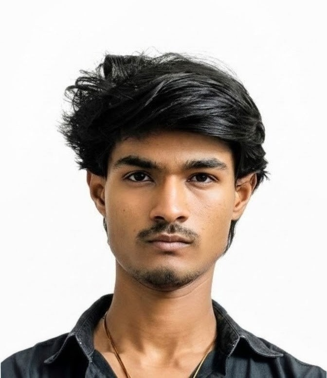

<h1 align="center">
  <br/>
  MANORANJAN L — Portfolio
</h1>

<p align="center">
  <b>Computer Science & Engineering (Data Science) · Backend Developer · AI Enthusiast</b><br/>
  MVJ College of Engineering, Bengaluru
</p>

<p align="center">
  <a href="https://my-portfolio-manuaradhya01.vercel.app" target="_blank">
    
  </a>
  &nbsp;
  <a href="https://github.com/Manuaradhya01/my-portfolio" target="_blank">
    
  </a>
  &nbsp;
  
</p>

---

## ✨ About

A **creative 3D-inspired editorial portfolio** built entirely with vanilla HTML, CSS, and JavaScript — no frameworks, no dependencies. Designed to feel like a premium print magazine brought to life on the web.

> 📍 Bengaluru, IN · 12.9716° N, 77.5946° E

---

## 🗂️ Sections

| # | Section | Description |
|---|---------|-------------|
| 00 | **Hero** | Interactive 3D-layered title with ambient canvas animation |
| 01 | **Selected Work** | Featured projects and case studies |
| 02 | **About** | Background, education & profile |
| 03 | **Technical Skills** | Tech stack and expertise |
| 04 | **Leadership & Initiative** | Clubs, events, and leadership roles |
| 05 | **Contact** | Get in touch |

---

## 🛠️ Built With


---

## ✨ Features

- 🎨 **Editorial Design** — Magazine-inspired layout with ink & paper grain SVG textures
- 🌀 **3D Perspective Hero** — Interactive tilt card with parallax depth layers
- ✨ **Ambient Dust Canvas** — Lightweight animated particle canvas overlay
- 🖱️ **Custom Cursor** — Dot + ring cursor with hover morphing (desktop only)
- 📜 **Scroll Progress Bar** — Reading progress indicator at the top
- 📱 **Fully Responsive** — Mobile drawer navigation with smooth transitions
- ⚡ **Zero Dependencies** — Pure HTML/CSS/JS, no frameworks needed
- ♿ **Accessible** — Semantic HTML5, ARIA labels, reduced-motion support

---

## 📁 Project Structure

```
my-portfolio/
├── manoranjan_protfolio/
│   ├── index.html        # Main portfolio page
│   ├── style.css         # All styles (Editorial design system)
│   ├── script.js         # Interactions, animations, cursor, canvas
│   ├── images/
│   │   └── profile.jpg   # Profile portrait
│   └── assets/
│       └── 3dprotfoliotheam.jpeg
├── vercel.json           # Vercel deployment config
├── .gitignore
└── README.md
```

---

## 🚀 Deployment

This site is deployed on **Vercel** with automatic deployments on every push to `master`.

```bash
# Clone the repo
git clone https://github.com/Manuaradhya01/my-portfolio.git

# Open in browser
cd my-portfolio/manoranjan_protfolio
start index.html
```

---

## 📬 Contact

| Platform | Link |
|----------|------|
| 📧 Email | manuaradhya2326@gmail.com |
| 🐙 GitHub | [@Manuaradhya01](https://github.com/Manuaradhya01) |
| 🌐 Portfolio | [my-portfolio on Vercel](https://my-portfolio-manuaradhya01.vercel.app) |

---

<p align="center">
  Made with ❤️ by <b>Manoranjan L</b> · © 2025–2026
</p>
